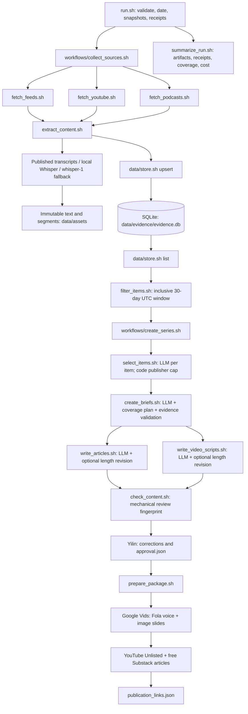

# Problem Set 4 Student Submission

**Student:** Yilin Jiang

**GitHub repository:** https://github.com/YilinJiang7/mit1.125/tree/main/pset4

**Publication:** Apprentice Mode

**Published evidence as-of date:** 2026-10-14 UTC (live run 2)

This repository implements the 16 required Bash entry points and retains two
live runs, an offline collection replay, a policy comparison, evidence versions,
model requests/responses, and human review. Course instructions remain unchanged
in [README.md](README.md) and [ARCHITECTURE.md](ARCHITECTURE.md), matching upstream
commit `5028d58`. The published series uses approved run 2; run 1 is a frozen,
not-for-publication baseline.

## Topic and Audience

The project settings are in [config/project.json](config/project.json).

- **Publication name:** Apprentice Mode. Learners are apprentices, and this
  course is an apprenticeship; “mode” describes how a learner should work with agents.
- **Topic:** AI coding agents (Codex, Claude Code, Copilot agent mode, Cursor and similar tools that plan, edit and run code) as they affect people who are still learning to program.
- **Audience and assumed knowledge:** Students in their first one or two years of programming, including graduate students outside computer science, who already use chatbots or coding agents for coursework and projects but cannot yet reliably judge whether the agent's code, explanations or tests are correct. They know basic Python, the terminal and git; they do not follow model benchmarks or developer-tools business news.
- **Central question:** As coding agents take on more of the work this month, what should a learning programmer delegate to them, what must they still be able to do and check themselves, and which claims about agents' speed, reliability and effect on learning are actually supported by evidence?
- **Reason for readers to return:** Agent tools change week to week; each edition tells a learner what changed, which claims held up, and one concrete habit to adopt or drop before the next edition.
- **Editorial voice:** Plain, calm and specific. Write like a careful senior student explaining to a classmate: define jargon once, separate what is known from what is claimed, never hype, and end with something the reader can do this week.

Included in scope:

- Releases and changes to coding agents that alter what a learner can delegate (autonomy, sandboxing, review, testing, pricing for students)
- Evidence about productivity, code quality, security and learning outcomes when people use coding agents
- Practitioner workflows and failure reports that a beginner can adopt or avoid
- Teaching and course-policy responses to coding agents

Excluded from scope:

- General model benchmark rankings with no coding-agent consequence
- Funding rounds, valuations and company drama
- Enterprise procurement and pricing beyond what a student would pay
- Speculation about AGI or job loss without concrete evidence

Policy v2 explicitly keeps student-relevant cost, speed and token-usage
explanations in scope, including vendor sources with commercial interests and
unverified claims clearly attributed.

## Published Series

The authoritative pairs are in
[publication_links.json](runs/20261014T165635Z-74b86f18/package/publication_links.json).
All articles are free and readable by everyone, without a paywall; they were
published on the web without email delivery. The videos are Unlisted on Yilin's
`@YilinJiang-r4l` YouTube channel. Each article links to and embeds its video;
each video description contains the article URL, dated source notes and AI disclosure.

| Piece | Title | Substack article | YouTube video |
| --- | --- | --- | --- |
| 01 | What Changed This Month: Voice-Driven Development, New Models, and Project-Aware Agents | [Read article](https://apprenticemode1.substack.com/p/what-changed-this-month-voice-driven) | [Watch video](https://youtu.be/l-P0u7Wtwqw) |
| 02 | Why Coding Agents Still Need Careful Checking: Trust, Failures, and How to Improve | [Read article](https://apprenticemode1.substack.com/p/why-coding-agents-still-need-careful) | [Watch video](https://youtu.be/KLvpVroriGE) |
| 03 | How Learners Should Work with Coding Agents Now: Guide to Delegation, Review, and Cost Management | [Read article](https://apprenticemode1.substack.com/p/how-learners-should-work-with-coding) | [Watch video](https://youtu.be/je0BnhWBX_8) |

**Separate technical demonstration video:** DEMO_LINK

Chrome Incognito checks confirmed full article text and video embeds without
login or payment, and playback of all three YouTube videos while signed out.
No Harvard-organization restriction appeared. YouTube currently requires
one-time channel verification to make external description URLs clickable;
the correct article URLs are saved and visible as text. Article-side links and
embeds work. Repackaging preserved all six URL values byte-for-byte.

| Piece | Reviewed article words | Reviewed script spoken words | Final MP4 length | Vids scenes |
| --- | ---: | ---: | --- | ---: |
| 01 | 870 | 518 | 3:24.9 | 5 |
| 02 | 875 | 670 | 4:22.4 | 6 |
| 03 | 775 | 635 | 4:08.7 | 6 |

Word counts use the mechanical review's counting rules, exclude source lists
and visual directions, and describe approved script artifacts. Production scene
splitting and the documented Theo wording clarification are a separate handoff.
MP4s were reviewed by Yilin before upload. Google Vids exports' subtitle tracks
were removed without re-encoding or changing the audio/video streams; YouTube
may independently offer its own automatic captions.

## Setup and Execution

### Dependencies and configuration

Verified on this Mac: Python **3.15.0**, jq **1.8.2**, yt-dlp **2026.08.19**,
ffmpeg **9.0.2** (also provides ffprobe), and system sqlite3 **3.43.2**.
Scripts support macOS Bash 3.2. Python helpers use the standard library;
already-installed local Whisper engines are optional. The initial setup installed
the missing yt-dlp and ffmpeg with Homebrew, including their dependencies.

```bash
brew install python jq yt-dlp ffmpeg sqlite
python3 --version
jq --version
yt-dlp --version
ffmpeg -version
sqlite3 --version
```

All commands in this document run from the `pset4/` folder. From the course
monorepo root, first run:

```bash
cd pset4
```

An untracked `.env` can supply local settings;
`run.sh` loads it without displaying values. Credential **names only**:

| Environment variable | Purpose/default |
| --- | --- |
| `OPENAI_API_KEY` | OpenAI credential for editorial generation and remote transcription fallback |
| `OPENAI_MODEL` | Editorial model; default `gpt-4.1-mini` |
| `MAX_AUDIO_MINUTES` | Maximum retained podcast audio per episode; default 45; development used 5 |
| `EVIDENCE_DIR` | Override evidence-store directory; default `data/evidence`; use a temporary directory for development |
| `SIMULATE_FAIL_SOURCE` | Optional source ID whose collector deliberately fails; explicitly labelled simulated |

Configure [project.json](config/project.json) with the topic, reader, question,
scope and voice. In [sources.json](config/sources.json), give each source a stable
`source_id`, shared originating `publisher_id`, `kind` (`feed`, `youtube`,
`podcast`), URL and optional collection limit. GitHub's blog/channel share one
publisher ID; arXiv is conservatively one publisher, not one per paper. Add
substantive relevance, evidence and uncertainty rules to
[editorial_policy.md](config/editorial_policy.md), and edit the four stage
instructions in [prompts/](prompts/). Every run snapshots these files before use;
changing current configuration does not rewrite an earlier run's instructions.

### Commands and behavior

```bash
bash run.sh
bash run.sh --package runs/20261014T165635Z-74b86f18
bash run.sh --resume runs/20261014T165635Z-74b86f18 --from check_content
bash run.sh --replay runs/20261013T035421Z-98ff50c1
bash run.sh --policy-compare runs/20261013T035421Z-98ff50c1
```

The general resume form is `bash run.sh --resume RUN --from STAGE`, where `RUN`
is a saved run directory and `STAGE` is `select_items`, `create_briefs`,
`write_content` or `check_content`. It preserves the original as-of date and
snapshots, records the resume reason and does not recollect. Resuming generation
can replace downstream outputs; the check-only example above preserves approved
content. A normal successful generation ends at `awaiting_review`; packaging
requires a passing current review and matching human `approval.json` and yields
`ready_for_production`. Partial collection remains explicit and can make a live
run exit 1 even when enough retained evidence supports the series.

Replay creates a new labelled run and uses saved candidates/assets without
network or store mutation. Policy comparison creates a different labelled replay,
snapshots the current policy/prompts, reuses saved eligible items, reruns selection
only, and writes `policy_diff.md`. These modes do not count as new live collection.
Their generic overall summary can say `failed` because no complete draft series
was generated: inspect `operation_status: completed` and the replay/diff proof
for the requested operation's actual result.

## Architecture and Manual Handoffs

### Implemented pipeline and model boundaries



The Bash entry point and workflows coordinate independently runnable components;
focused Python helpers belong beside their owning stage. A real pipe in the
collection workflow passes saved candidates into content extraction; the resulting
`items.jsonl` is then redirected into store upsert. Only
[data/store.sh](data/store.sh) and its helper access the persistent SQLite index;
all other components query its `init`, `upsert RUN`, `list`, `get ITEM_ID
[VERSION_ID]` and diagnostic `stats` interface. Tables record stable items,
immutable versions and run observations. For a standalone store inspection,
omit inherited `RUN_DIR` or set it to a disposable diagnostic run to avoid adding
receipts to a frozen baseline.

All model access goes through [lib/llm_client.py](lib/llm_client.py).
`gpt-4.1-mini` is used for selection, briefs, articles, scripts, repair calls and
length revision, with JSON mode where structured output is expected. Transcription
first uses a published timed transcript, then an installed local Whisper engine,
otherwise `whisper-1` on compressed ten-minute chunks up to the episode cap.
Real whisper-1 transcription succeeded for Changelog/SEDaily. Requests and raw
responses are retained under each run's `llm/<stage>/`; model usage, tools,
timings, failures and estimated costs are in `logs/` receipts. Prices in
[lib/prices.json](lib/prices.json) are estimates: $0.40/$0.10/$1.60 per million
uncached-input/cached-input/output tokens and $0.006 per audio minute for Whisper.
These are recorded accounting assumptions, not an invoice or a claim of today's prices.

Code samples media segments across the whole **retained** transcript using
evenly spaced windows plus project-keyword matches, skipping obvious sponsor
reads, with a 6,000-character cap and `[segment_id mm:ss] text` lines. Sampling
details are saved in receipts. This cannot recover material beyond an audio cap
or guarantee every relevant passage is selected. Briefs receive accepted evidence
only. Exact text quotes, segment IDs and item/version pairs are checked;
every piece needs three publishers and the series uses all three kinds. A failed
brief gets the exact errors for up to two repairs, then fails explicitly.
Code appends source lists, grouping claim markers by distinct item/locator.
An article outside 600–900 body words gets one 650–850-word revision; a script
outside 450–700 spoken words gets one 500–650-word revision, preserving markers.
Persistent length misses remain warnings for human review.

### Evidence storage, identities and media retrieval

[data/assets/](data/assets/) contains retained readable text and timestamped
`.segments.json` arrays. Items reference these immutable paths. Stable IDs use
the native YouTube video ID, a podcast GUID/enclosure SHA-1, or a canonical-URL
SHA-1 for feeds. `version_id` is SHA-256 over UTF-8 JSON with sorted keys,
compact separators and `ensure_ascii=False`, containing `item_id`, `title`,
`url`, `published_at`, `media_url`, `sha256_text_path` (text-byte digest) and
`sha256_segments_path` (segment-byte digest, or null). `retrieved_at` is excluded.
An unchanged version cannot create a second version. Cross-kind podcast/YouTube
copies with matching normalized titles and dates within three days are flagged
`duplicate_of` and counted once; differently titled copies still need human reconciliation.

Raw downloads and audio chunks are under ignored `data/media/`, not in Git.
For independent refetching, obtain the pinned candidate's `url`/`media_url` from
saved `candidates.jsonl` or `items.jsonl`. Download written pages/feed data from
their URLs; for YouTube captions use:

```bash
yt-dlp --skip-download --write-subs --write-auto-subs --sub-format vtt \
  --output '/tmp/apprentice-source/%(id)s.%(ext)s' 'https://www.youtube.com/watch?v=vRS2leJLAI0'
```

Podcast audio can be downloaded from the exact enclosure URL in the saved
`media_url`, using `curl --location` and an explicit output path under `/tmp`.
A fresh `bash run.sh` also fetches configured sources and
records new observations; it does not reproduce an old run's date. Offline
replay needs no raw media because the exact retained text/segments are submitted.
Some upstream captions may later be unavailable: do not substitute a new transcript
for an earlier version or overwrite its referenced assets.

### Human review and production handoffs

1. **Review:** inspect `decisions.jsonl`, `briefs.jsonl`, `articles/`,
   `video_scripts/`, evidence and `review.json`. Human corrections R1–R7 are
   recorded in [the run 2 review](reviews/run2_editorial_review.md); rerun only
   `--from check_content`. Yilin's [approval](runs/20261014T165635Z-74b86f18/approval.json)
   matches the resulting review ID. Mechanical checks cannot approve factual
   interpretation on the editor's behalf.
2. **Package:** `--package` verifies unchanged assessed inputs and matching approval,
   then copies three article/script pairs plus per-piece source notes. See the
   [manifest](runs/20261014T165635Z-74b86f18/package/manifest.json).
3. **Google Vids:** pass `package/publish_kit/vids_01.md`, `vids_02.md`, `vids_03.md`
   (scene ideas, sources and narration) plus `vids_01_scenes.txt`,
   `vids_02_scenes.txt`, `vids_03_scenes.txt` (exact ≤800-character narration
   blocks) into three Landscape files. Use no avatar, the same English **Fola**
   AI voiceover, and consistent light image slides with headlines, qualifiers,
   dated source footers and AI disclosure. Fit scene duration to audio, review
   playback, export MP4, and have Yilin watch the final videos.
4. **YouTube/Substack:** upload MP4s as Unlisted, not made for kids and without
   paid promotion, using `youtube_01.txt`–`youtube_03.txt` descriptions and titles.
   Paste `substack_01.html`–`substack_03.html` into free Substack drafts, insert
   each matching video embed after the opening paragraph, and link the bottom
   video reference. Publish web-only, then replace each YouTube article placeholder
   with the published URL. The final video 01 narration clarification (“Theo,
   a developer YouTuber”) is recorded in the review; approved script files remain intact.
5. **Verify:** enter real pairs in `package/publication_links.json`, repackage to
   prove preservation, and open all six links signed out. Production instructions
   in the package describe the handoff; the real URLs and this submission record
   its completed publication status. A separate 4–6-minute technical demo remains
   to be linked above.

## Evidence and Runs

The four retained runs are linked below. API costs are **estimates from saved
receipts**. The replay cost is zero because it makes no model/network calls.
No unknown API costs are reported for these four runs; their combined estimate
is **$1.5548764**, excluding earlier development and unrelated tool subscriptions.

| Run / purpose | Execution date; evidence as-of date | Artifacts | Timing from summary / receipts | Estimated API cost |
| --- | --- | --- | --- | ---: |
| Live 1 `20261013T035421Z-98ff50c1`: frozen policy v1 baseline; initial briefs failure, then resume; approval **revise** | 2026-10-13; 2026-10-13 | [summary](runs/20261013T035421Z-98ff50c1/summary.json), [logs](runs/20261013T035421Z-98ff50c1/logs/), [approval](runs/20261013T035421Z-98ff50c1/approval.json) | Summary span 3,350.702 s including pause; active initial 539.822 s + resume 114.992 s | $0.9667332 |
| Offline replay `20261013T063437Z-eb299023`: collection only, no new evidence | 2026-10-13; 2026-10-13 | [summary](runs/20261013T063437Z-eb299023/summary.json), [replay proof](runs/20261013T063437Z-eb299023/replay_check.json) | 4.235 s | $0.0000000 |
| Policy comparison `20261014T165323Z-8c1b9df6`: v2 selection on run 1's exact eligible inputs | 2026-10-14; retained **2026-10-13** | [summary](runs/20261014T165323Z-8c1b9df6/summary.json), [policy diff](runs/20261014T165323Z-8c1b9df6/policy_diff.md) | 78.429 s | $0.0693556 |
| Live 2 `20261014T165635Z-74b86f18`: policy v2; approved and published | 2026-10-14; 2026-10-14 | [summary](runs/20261014T165635Z-74b86f18/summary.json), [logs](runs/20261014T165635Z-74b86f18/logs/), [review](runs/20261014T165635Z-74b86f18/review.json), [approval](runs/20261014T165635Z-74b86f18/approval.json) | Current summary span 171,678.975 s includes later human review/publication waits; initial 476.007 s + content resume 157.740 s; check-only resume 1.317 s; package runs 3.319 s and 3.458 s | $0.5187876 |

Do not add overlapping stage durations as though they were independent work.
The long summary spans measure first start through latest retained receipt,
not continuous CPU time. The baseline summary remains `awaiting_review`, while
Yilin's later immutable baseline approval says `revise`; run 2's current summary
says `ready_for_production`, and its recorded URLs show actual publication.

### Coverage, changes and honest failures

| Measured coverage | Live run 1 | Live run 2 |
| --- | ---: | ---: |
| Distinct eligible items / independent publisher IDs | 44 / 9 | 64 / 11 |
| Eligible feed / YouTube / podcast | 32 / 3 / 9 | 43 / 10 / 11 |
| Accept / reject / defer | 14 / 28 / 2 | 17 / 42 / 5 |
| Accepted feed / YouTube / podcast | 12 / 1 / 1 | 12 / 3 / 2 |
| Actually cited distinct items | 10 | 9 |

Run 2 ingested **20 new / 12 changed / 17 unchanged** items relative to the
store after run 1; retained unchanged items remain eligible. “Changed” means a
version fingerprint changed, not proof of a meaningful new development.
The 20 new items include Simon Willison's *llm-gemini 0.35*, Theo's *So I've
been testing Gemini 4...*, GitHub's Copilot Day live coding, new Fireship videos,
a YC camera video, a Latent Space Dyna-2 episode and SEDaily's Jev/Meta news.
The exact new IDs and versions are in
[changes.jsonl](runs/20261014T165635Z-74b86f18/changes.jsonl), joined by `item_id`
to [items.jsonl](runs/20261014T165635Z-74b86f18/items.jsonl).
PrimeTime and Y Combinator were newly configured after recent-video verification;
PrimeTime's three discovered videos all lacked reachable captions. CS50 was
checked but skipped because it had no videos in the then-current 30-day window.
The resulting set still lacks direct learner/educator voices.

Run 2's eligible publisher counts are: Simon Willison 17, Stack Overflow 8,
GitHub 8, Pragmatic Engineer 7, Latent Space 7, Theo 5, arXiv 4, SEDaily 3,
Fireship 3, Changelog 1 and Y Combinator 1. The accepted set has six publishers:
GitHub, Simon Willison, Stack Overflow, arXiv and Theo each have three; Latent
Space has two. Publication uses **6 feed + 2 YouTube + 1 podcast** items across
six publishers; every piece has at least three publishers and all three kinds
contribute across the series. The summary's `series_coverage.passed: false`
applies the stricter collection minimum (12 items / 2 per kind) to cited items;
collection and accepted coverage pass those minima, while content review checks
the required three publishers per piece and all kinds across the series.

- **Duplicate/replay proof:** [replay_check.json](runs/20261013T063437Z-eb299023/replay_check.json)
  has `passed: true`, 44 `unchanged`, zero new/changed, and identical before/after
  counts: 44 items, 44 versions, 44 observations, plus identical database SHA-256.
  This offline replay does not even add observations. Neither live run reports
  a duplicate observation; the conservative cross-kind heuristic is not a
  guarantee of detecting every differently titled copy.
- **Date window:** run 1 uses 2026-09-14…2026-10-13 UTC; run 2 uses
  2026-09-15…2026-10-14 UTC, each inclusive. [Run 2 exclusions](runs/20261014T165635Z-74b86f18/exclusions.jsonl)
  is empty because no retained corpus item fell outside that window. The labelled
  [filter fixture](examples/filter_input.jsonl) and [expected results](examples/filter_expected.json)
  exercise both boundary dates and `outside_window`, `unknown_date`, `future_date`
  and `invalid_date`; fictional fixture items are not counted as evidence.
- **Discovery/caption failures:** run 1's Fireship/GitHub channel RSS requests
  ended in HTTP 404 (one GitHub attempt first returned 500). Later code adds
  yt-dlp flat-ID discovery plus per-video upload dates after RSS failure; method
  and attempts remain in receipts. Run 2 still has **seven** caption failures:
  two GitHub, three PrimeTime and two YC videos. 56 discovered candidates yielded
  49 extracted records; collection is explicitly incomplete despite enough coverage.
- **Brief validation and recovery:** run 1's first response and repair omitted
  YouTube evidence. Validation stopped the run. Code now constructs and saves a
  coverage plan before prompting, and repair requests carry the exact validator
  errors. Resume from `create_briefs` preserved original selection, policy v1,
  receipts and date; successful and failed requests remain under
  [run 1 llm/](runs/20261013T035421Z-98ff50c1/llm/).
- **False-review disclosure guardrail:** run 2's article writer refused a model
  statement claiming human review had already happened. The failed receipt says
  “Human review is pending; do not claim it occurred.” A code-level execution-status
  instruction corrected generation, and resume from `write_content` reused the
  saved decisions/briefs. Only after Yilin's actual corrections did the disclosure
  change to editor-reviewed. Original failures remain in [run 2 llm/](runs/20261014T165635Z-74b86f18/llm/)
  and `logs/`.
- **Simulated failure:** `SIMULATE_FAIL_SOURCE` was tested in an isolated development
  run and returned exit 1 with `simulated: true`. **Neither live run is simulated**;
  their reported source failures are real. Local development notes are intentionally
  excluded from the submitted repository.

### Trace: published claim 02-c3

1. In [briefs.jsonl](runs/20261014T165635Z-74b86f18/briefs.jsonl), claim `02-c3`
   is `reported_fact`: “The decline in trust from 43% to 33% comes from Stack Overflow’s 2024 and 2025 Developer Surveys, cited in Chase Hughes’s Oct 8, 2026 article, not new measurements this month. Hughes argues that silent failures worsen this trust gap despite increased AI-tool usage.”
2. Its evidence points to `feed:2e5589be400de24e757a3a054853d18196402441`, version
   `b51e0a4dc46e1b7dcc43e4305e9754691fa6bfd9551ff38dc66aae35f5914715`, with this exact retained-text quote:

   > Donovan cites this site's own Developer Survey on the trust divergence, and it's worth pulling the primary figures because the shape is stark. Between the 2024 and 2025 surveys, the share of developers using or planning to use AI tools rose from 76% to 84%, while the share who trust the accuracy of what those tools produce fell from 43% to 33%. Active distrust went the other way, from 30% to 46%. The single biggest frustration, cited by 66%, was "AI solutions that are almost right, but not quite."

3. [decisions.jsonl](runs/20261014T165635Z-74b86f18/decisions.jsonl) accepts this
   same item/version because a green exit code can conceal no real work and
   learners need verification. Its proposed `piece_ids` is `["01"]`; the actual
   briefs use it in 02 and 03, recorded in
   [item_usage.jsonl](runs/20261014T165635Z-74b86f18/item_usage.jsonl).
4. The pinned record was verified through the store interface:

   ```bash
   env -u RUN_DIR -u EVIDENCE_DIR bash data/store.sh get \
     feed:2e5589be400de24e757a3a054853d18196402441 \
     b51e0a4dc46e1b7dcc43e4305e9754691fa6bfd9551ff38dc66aae35f5914715
   ```

   Its retained [text file](data/assets/feed_2e5589be400de24e757a3a054853d18196402441/b51e0a4dc46e1b7dcc43e4305e9754691fa6bfd9551ff38dc66aae35f5914715.txt) contains the quote as an
   exact substring. Source: [A green exit code is not evidence that the work happened](https://stackoverflow.blog/2026/10/08/a-green-exit-code-is-not-evidence-that-the-work-happened),
   Stack Overflow, published 2026-10-08T14:00:00Z. The source is an October 2026
   discussion citing older survey results; the primary surveys were not separately
   collected as fresh 2026 evidence.
5. Human correction **R2** in [run2_editorial_review.md](reviews/run2_editorial_review.md)
   explicitly dates the figures to the 2024 and 2025 surveys and removes the false
   description of the silent-failure discussion as a “2024 study.” The
   [published article 02](https://apprenticemode1.substack.com/p/why-coding-agents-still-need-careful) says: “Chase Hughes’s Oct 8,
   2026 article cites Stack Overflow’s 2024 and 2025 Developer Surveys: AI tool
   usage rose from 76% to 84%, trust fell from 43% to 33%, and active distrust
   rose from 30% to 46%. These are historical survey results, not new measurements
   this month.” Its numbered source `[1]` resolves to the same Stack Overflow URL;
   the saved [publishing HTML](runs/20261014T165635Z-74b86f18/package/publish_kit/substack_02.html)
   and approved article retain the same correction.

## Editorial Review

Read [policy v1](reviews/editorial_policy_v1.md), [current policy v2](config/editorial_policy.md),
the [stage prompts](prompts/), [run 1 review](reviews/run1_editorial_review.md),
[run 2 review](reviews/run2_editorial_review.md), and the saved
[policy_diff.md](runs/20261014T165323Z-8c1b9df6/policy_diff.md). Each live run
also retains the policy and prompts actually supplied to its models.

Yilin reviewed **three accepts plus four rejects/defers** from run 1: Simon
Willison's voice workflow, GitHub ReviewBench, Stack Overflow's green-exit
article, Changelog NanoClaw, Latent Space's Thariq interview, Theo's cost video,
and Willison's Dwarf Fortress item. She agreed with accepting the voice workflow
but corrected the expert-as-learner error; agreed with Stack Overflow and the
off-topic Dwarf Fortress reject; preferred deferring ReviewBench; and disputed
the intro-based NanoClaw rejection, Thariq deferral and Theo cost-video deferral.
The review distinguishes assistant suggestions from Yilin's own decisions.

V2 adds accurate expertise descriptions; whole-retained-transcript sampling;
an explicit cost/token relevance rule; source-claim labels and commercial-interest
disclosure for vendor numbers; a three-item publisher cap; normally one, at most
two proposed pieces per item; and an active search for tension in piece 02
without manufacturing disagreement. **Yilin rejected** a proposed blanket rule
requiring independent corroboration before using any vendor efficiency claim:
student costs remain relevant even when only vendor evidence exists, provided
the claim is attributed and its uncertainty stated.

On the same 44 eligible inputs, v2 comparison changed **nine decision labels**;
15 items changed decision and/or proposed piece assignments. GitHub accepts fell
from six to three. The comparison is an observed rerun, not a controlled estimate
of policy alone: sampling/code and stochastic model judgment also affect results.
Run 2's publisher-cap code ranks `data > method > first_hand > demo > assertion > none`,
then most recent date, then stable item ID. Overflow accepts become defer with
empty piece IDs and an explicit publisher-cap reason. `model_decision` and
`model_reason` preserve the model's original output beside any code override.

Yilin's run 2 corrections, with exact before/after spans in the review, are:

| Correction | Human change and reason |
| --- | --- |
| R1 | `02-c6`, `03-c5` become `source_claim`; identify the Anthropic employee discussing Anthropic's own product and commercial interest |
| R2 | Attribute 43%→33% trust to the 2024/2025 surveys cited in the recent article; correct the false “2024 study” framing |
| R3 | `01-c8` becomes `source_claim`; Theo's own testing is one creator's account, not independent evaluation |
| R4 | HiSentinel is a non-peer-reviewed arXiv preprint on the authors' benchmarks, worth watching, not adopting; `03-c4` becomes `source_claim` |
| R5 | Trim article 03 from 1,004 to 775 body words, preserving every numbered claim marker and adding no facts |
| R6 | Remove article 01's three unresolvable `[limitations]` labels |
| R7 | After real human review, replace pending-review language in all six drafts with the editor-reviewed AI-assistance disclosure |

The current mechanical review passes with three standard “needs human judgment”
warnings and no blocking or length issues. Its fingerprint matches Yilin's
`approve` decision and the package manifest. Human review remains substantive
evidence, not something the automated warning can establish. The subsequent
video 01 narration clarification changes “Theo, the video's creator” to “Theo,
a developer YouTuber,” preserving the fact and avoiding confusion with our video.

Two disagreements remain visible: AI **accepts ReviewBench**, while Yilin
would **defer** it as a vendor team-tool benchmark with little learner action;
AI **rejects NanoClaw**, while Yilin would **accept/defer** its agent-project
discussion. Neither is used in any published piece, so their saved decisions
remain unchanged. Policy improvement did not eliminate every editorial disagreement.

**Usage-map gap:** the selector assigned all 17 run 2 accepts to piece 01.
Brief synthesis reallocated sources and cited 9 distinct accepted items;
eight accepts were unused. [item_usage.jsonl](runs/20261014T165635Z-74b86f18/item_usage.jsonl)
records one row for every accept, including `decision_piece_ids`, actual
`used_in_pieces` and `claim_ids` (empty arrays for unused items). This makes the
gap inspectable without rewriting approved decisions or pretending intended
assignments were actual use.

## Reflection

**Insight.** Trust in agents comes from verification around the model, not a
success signal. The green-exit failure report and production-maturity framework
connect to a concrete learner habit: write an independent check before accepting
“done.” Vendor advice about spending effort and tokens complements this habit,
but is evidence of what the vendor recommends, not independent proof of reliability.

**Failure and limitation.** Run 1 judged media largely by introductory excerpts,
so sponsor reads distorted editorial decisions. Distributed sampling improves
coverage but cannot eliminate sampling bias or the audio cap. The piece-assignment
gap also survived v2; a valid per-item decision is not a coherent series plan.
There are no direct learner/educator voices in the published evidence: CS50 had
no recent videos in the checked window, and expert workflows do not establish
beginner learning outcomes. Some source pages are paid previews, explicitly
labelled in summaries; source counts alone do not establish substantive quality.

**Next improvement.** Add a series-level allocation review after per-item
selection: reconcile proposed and actual use, explain unused accepts, check
overlap and missing perspectives, and obtain learner/educator evidence before
making claims about educational benefit. Inspect uncertain transcript samples
with the full retained text and keep testing commercial claims against genuinely
independent evidence when it exists.

**Architectural tradeoff.** Per-item LLM selection is cheap, inspectable and
resumable, but lacks a full global comparison. It receives a short history of
earlier accepts, not the complete future candidate set. I kept the component
simple and enforced the publisher cap in code after all decisions, preserving
the model's original decision/reason and documenting actual use separately.
Mechanical validation and human approval provide complementary checks; neither
proves an interpretation correct. This small pipeline makes those boundaries
visible rather than hiding judgment inside orchestration.
